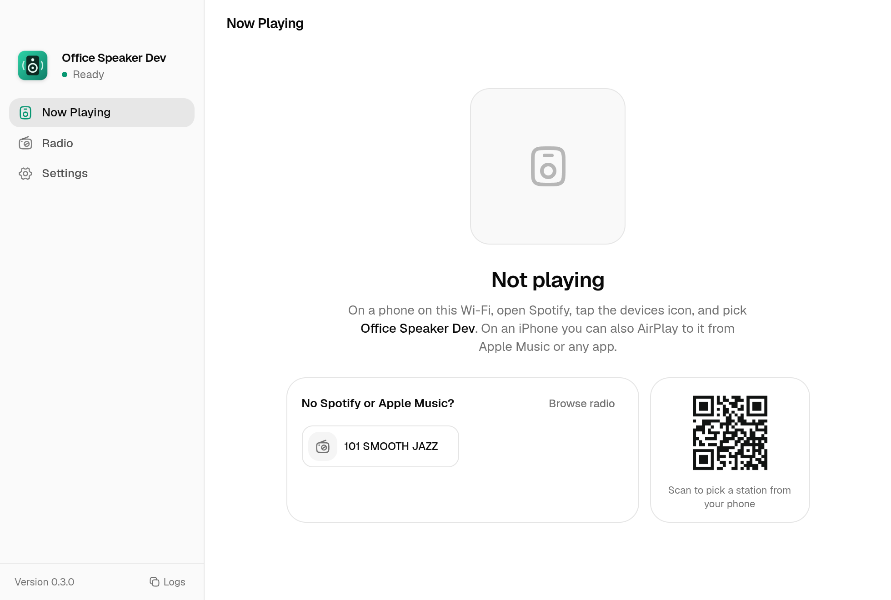
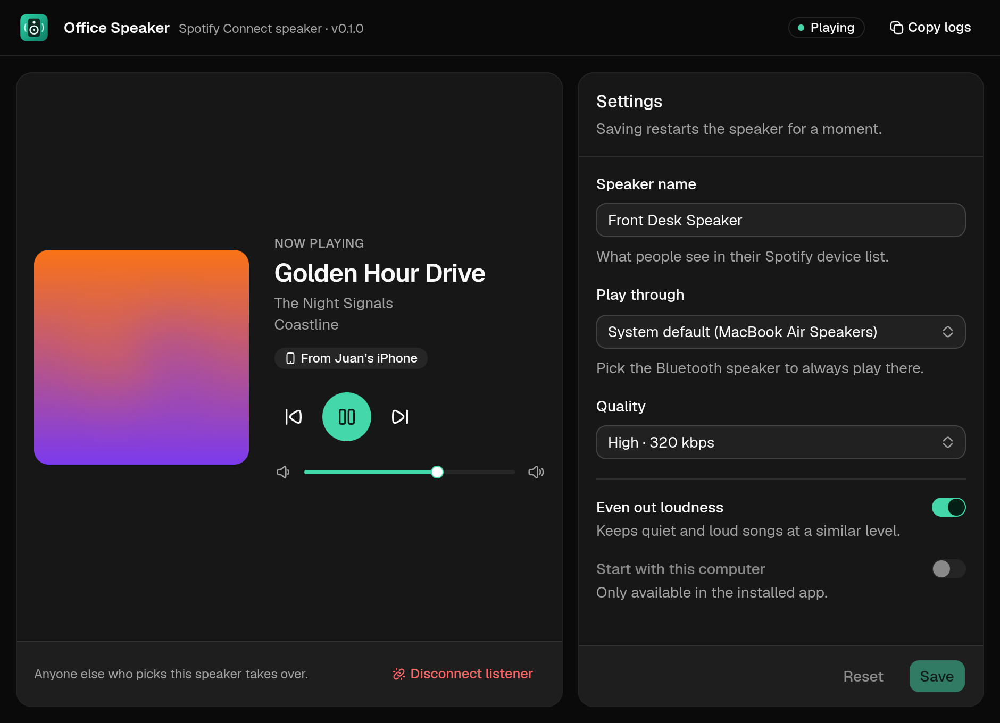

# Office Speaker

Turns a Mac or Windows computer into a Spotify Connect speaker. Anyone on the same network opens Spotify on their phone, taps the devices icon, and picks the computer. Nobody signs in to Spotify on the computer. Audio plays through the computer's sound output, so a Bluetooth speaker paired to the computer works.

It runs [Spotify Soloist](https://developer.spotify.com/documentation/soloist), Spotify's official headless player, wrapped in a menu bar / tray app. (Version 0.1 used librespot, which stopped working for Spotify accounts created after late 2024.)





## Using it

1. Install it on the computer connected to the speaker.
2. On first launch, name the speaker and paste a **Spotify Soloist API key**. Someone with Spotify Premium creates one in the [Spotify developer dashboard](https://developer.spotify.com/dashboard) by clicking **Spotify Soloist API Key**. Office Speaker then downloads Soloist from Spotify's servers.
3. Leave it running. It lives in the menu bar (Mac) or system tray (Windows) and starts at login.
4. On a phone on the same Wi-Fi: Spotify → devices icon → pick the speaker. Free and Premium accounts both work.

Whoever picks the speaker last takes over, like a normal Connect speaker. People can also join the current listener's Jam and add songs from their own account. The window and tray show what's playing and include **Disconnect listener**, which signs that person out. Nobody stays signed in after the app restarts.

### Requirements and limits

- **Apple Silicon Mac (macOS 13+) or x86_64 Windows.** Those are the desktop platforms Soloist supports. Intel Macs aren't supported.
- **A Soloist API key.** It is created once by someone with Premium and stored encrypted on the computer.
- **Same network.** Discovery uses mDNS/Bonjour. Wi-Fi with client isolation or blocked multicast hides the speaker, as it would a Sonos.
- **Soloist updates.** Each Soloist build works for 90 days. Office Speaker checks Spotify's servers twice a day and swaps in new builds between songs. If Spotify stops publishing builds, the speaker stops working when the last build expires, and the app warns 14 days ahead.
- **Spotify's terms.** Soloist can't be redistributed, so it's never bundled. Each computer downloads it from Spotify after the user agrees to Spotify's terms. Spotify's terms don't clearly address using Soloist this way.
- **Output device.** On Mac and Windows, Soloist plays to the system default output.
- **Mac discovery.** Soloist's own network announcement doesn't work on Macs ([spotify/soloist#33](https://github.com/spotify/soloist/issues/33)). Office Speaker announces the speaker through Bonjour instead.

## Installing builds

GitHub Actions builds an Apple Silicon DMG and a Windows installer on every push. Pushing a `v*` tag also attaches them to a GitHub release. The builds aren't code-signed yet:

- **macOS:** open the app, dismiss the warning, then go to System Settings → Privacy & Security → **Open Anyway**. Allow **Local Network** access when asked.
- **Windows:** SmartScreen shows "Windows protected your PC". Click **More info** → **Run anyway**. The installer asks for admin rights so it can add firewall rules.

## Development

Requirements: Node 24.

```sh
npm install
npm start          # builds the window with Vite, then launches the app
npm run typecheck
```

Layout:

- `src/soloist.js` downloads Soloist from Spotify's CDN, verifies the signature (Spotify's Apple team ID or Authenticode), and tracks the build's expiry. It also clears the stored session so the listener is signed out.
- `src/announce.js` checks whether Soloist's own mDNS announcement is visible. If not, it announces Soloist's Connect endpoint through `dns-sd` on macOS and `bonjour-service` elsewhere.
- `src/main.js` is the Electron main process. It handles the tray menu, settings, and the encrypted API key. It supervises Soloist: restarts with backoff, restarts after sleep, and auto-updates. It reads playback events from Soloist's local WebSocket API.
- `renderer/` is the window: React, Tailwind v4, and shadcn components on Base UI (`components.json`, `base-nova` style) with Hugeicons. Vite builds it to `dist-renderer/`, which Electron loads from disk. Add components with `npx shadcn@latest add <name>`.
- `src/preload.js` is the bridge between the window and the main process (`window.speaker`).
- `OFFICE_SPEAKER_SOLOIST_DIR=/path npm start` keeps Soloist, its data, and its cache in a different folder.
- `build/installer.nsh` creates Soloist's folder under ProgramData, which users can write to. It also adds the Windows firewall rules.
