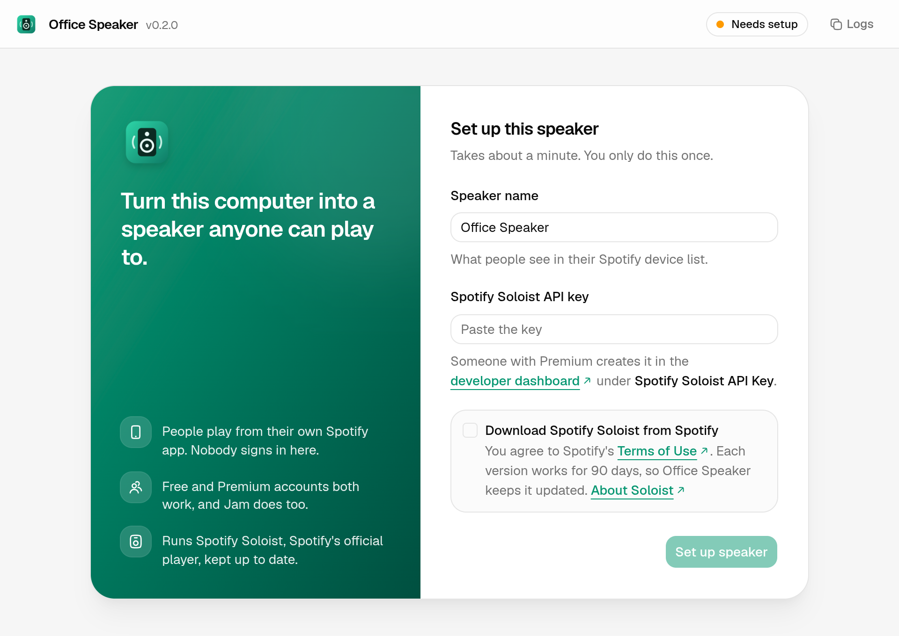
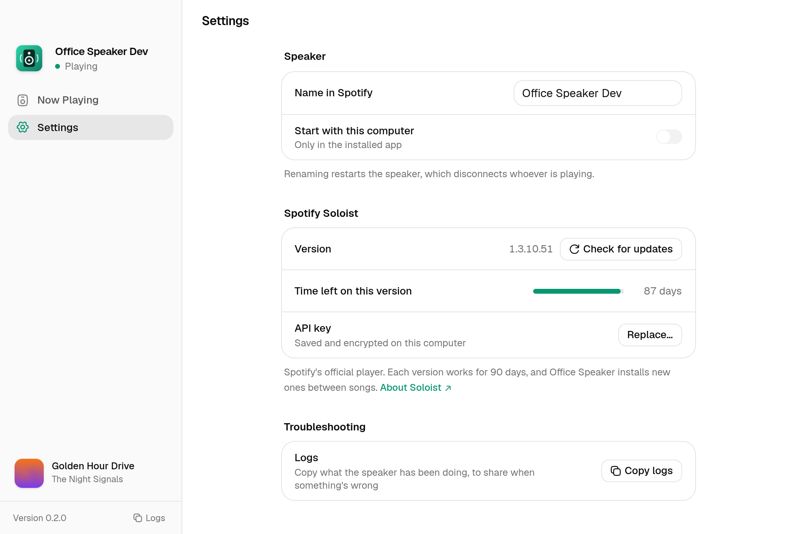
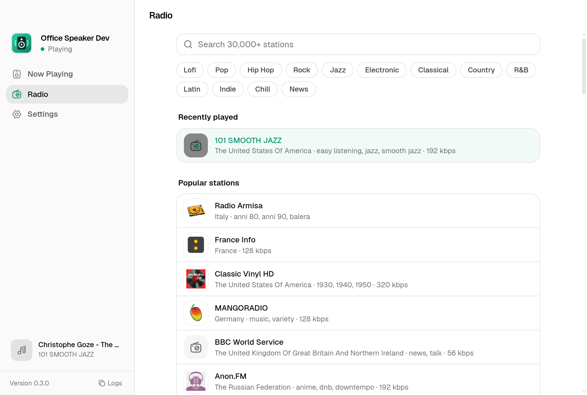

# Office Speaker

Turns a Mac or Windows computer into a speaker anyone in the office can play to. Pair a Bluetooth speaker with the computer, run Office Speaker, and people play from their own phones:

- **Spotify:** pick the speaker in Spotify's devices list. Nobody signs in on the computer, and Free and Premium accounts both work.
- **AirPlay:** play from Apple Music or any app on an iPhone, iPad or Mac.
- **Radio:** no account needed. Search about 30,000 internet radio stations in the app, or from a phone via a QR code.

Whoever plays last takes over, like a normal speaker.

**[Download the latest release](https://github.com/JuanQuenga/office-speaker/releases/latest)** for Apple Silicon Macs (`.dmg`) or Windows (`.exe`).

For Spotify it runs [Spotify Soloist](https://developer.spotify.com/documentation/soloist), Spotify's official headless player, wrapped in a menu bar / tray app. (Version 0.1 used librespot, which stopped working for Spotify accounts created after late 2024.)

Office Speaker isn't affiliated with or endorsed by Spotify or Apple.








## AirPlay

People with an iPhone, iPad or Mac can AirPlay to the speaker too, from Apple Music or any app. Whoever plays last takes over, whether that's AirPlay or Spotify. The window shows the song, artwork and progress, and play/pause/skip control the phone.

- **Windows:** Office Speaker has a built-in AirPlay receiver (Settings → AirPlay). It's the classic AirPlay audio protocol that shairport-sync implements, using a JavaScript port of Apple's open-source ALAC decoder. It's audio only, with no multi-room sync.
- **macOS:** use the AirPlay Receiver built into macOS (System Settings → General → AirDrop & Handoff). Set **Allow AirPlay for** to **Anyone on the same network**. Settings → AirPlay has a shortcut there.

## Radio and the phone page

People without Spotify or Apple Music can put on internet radio. The **Radio** page searches about 30,000 stations from [Radio Browser](https://www.radio-browser.info), a free, community-run directory, and has genre shortcuts, favorites and recently played. When a station sends song titles (ICY metadata), they show as now playing.

The **phone page** is a small web page the app serves on the office network. The idle screen and Settings show a QR code for it. Anyone on the Wi-Fi can open it, with no app to install, to see what's playing and pick a station. It only offers stations from the directory, so it can't make the speaker fetch arbitrary URLs. You can turn it off in Settings.

Radio, Spotify and AirPlay follow one rule: whoever plays last takes over.

(YouTube isn't included. YouTube blocks most music videos in embedded players unless the player is hosted on a public website, and ripping audio from YouTube, as old Discord bots did, is against YouTube's terms.)

## Using it

1. Install it on the computer connected to the speaker.
2. On first launch, name the speaker and paste a **Spotify Soloist API key**. Someone with Spotify Premium creates one in the [Spotify developer dashboard](https://developer.spotify.com/dashboard) by clicking **Spotify Soloist API Key**. Office Speaker then downloads Soloist from Spotify's servers.
3. Leave it running. It lives in the menu bar (Mac) or system tray (Windows) and starts at login.
4. On a phone on the same Wi-Fi: Spotify → devices icon → pick the speaker. Free and Premium accounts both work.

Whoever picks the speaker last takes over, like a normal Connect speaker. People can also join the current listener's Jam and add songs from their own account. The window and tray show what's playing and include **Disconnect listener**, which signs that person out. Nobody stays signed in after the app restarts.

### Requirements and limits

- **Apple Silicon Mac (macOS 13+) or x86_64 Windows.** Those are the desktop platforms Soloist supports. Intel Macs aren't supported.
- **A Soloist API key.** It is created once by someone with Premium and stored encrypted on the computer.
- **Same network.** Discovery uses mDNS/Bonjour. Wi-Fi with client isolation or blocked multicast hides the speaker, as it would a Sonos.
- **Soloist updates.** Each Soloist build works for 90 days. Office Speaker checks Spotify's servers twice a day and swaps in new builds between songs. If Spotify stops publishing builds, the speaker stops working when the last build expires, and the app warns 14 days ahead.
- **Spotify's terms.** Soloist can't be redistributed, so it's never bundled. Each computer downloads it from Spotify after the user agrees to Spotify's terms. Spotify's terms don't clearly address using Soloist this way.
- **Output device.** On Mac and Windows, Soloist plays to the system default output.
- **Mac discovery.** Soloist's own network announcement doesn't work on Macs ([spotify/soloist#33](https://github.com/spotify/soloist/issues/33)). Office Speaker announces the speaker through Bonjour instead.

## Installing builds

Download the `.dmg` (Apple Silicon Mac) or `.exe` (Windows) from [Releases](https://github.com/JuanQuenga/office-speaker/releases). GitHub Actions builds both on every push and attaches them to a release when a `v*` tag is pushed. The builds aren't code-signed yet:

- **macOS:** open the app, dismiss the warning, then go to System Settings → Privacy & Security → **Open Anyway**. Allow **Local Network** access when asked.
- **Windows:** SmartScreen shows "Windows protected your PC". Click **More info** → **Run anyway**. The installer asks for admin rights so it can add firewall rules.

## Updates

- **Windows:** new versions download in the background, then **Settings → Restart to update** installs them. Installing asks for admin approval, so it never restarts on its own.
- **macOS:** builds aren't signed, so they can't update themselves. The app tells you when a new version is out and links to the download.

## Privacy and network

- **Listening on the network:** Office Speaker listens on the local network for Spotify Connect (through Soloist), AirPlay (Windows, port 5000 when free), and the phone page (port 7979 when free). You can turn off AirPlay and the phone page in Settings.
- **Outbound connections:** it only talks to Spotify (Soloist downloads and updates), Radio Browser (station search), the radio stations you play, and GitHub (app updates).
- **The Soloist API key:** stored encrypted with the OS keychain. It's passed to Soloist on its command line, because that's the only way Soloist accepts it ([spotify/soloist#12](https://github.com/spotify/soloist/issues/12)). That means other users on the same computer could see it in a process list.
- **Nothing else leaves the computer:** no analytics, telemetry or accounts.

## Development

Requirements: Node 24.

```sh
npm install
npm start          # builds the window with Vite, then launches the app
npm run typecheck
npm test           # ALAC decoder round trip
```

`test/windows-smoke.mjs` runs in CI on a real Windows machine and must pass before a release. It installs the real installer, then runs setup with the real Soloist download, AirPlay with a scripted sender, radio, the phone page, source takeover, stray-process cleanup, an upgrade, a real auto-update and an uninstall. It can't cover an actual Spotify login, a real iPhone or a real audio device. Results, screenshots and logs are attached to each run.

Layout:

- `src/soloist.js` downloads Soloist from Spotify's CDN, verifies the signature (Spotify's Apple team ID or Authenticode), and tracks the build's expiry. It also clears the stored session so the listener is signed out.
- `src/announce.js` checks whether Soloist's own mDNS announcement is visible. If not, it announces Soloist's Connect endpoint through `dns-sd` on macOS and `bonjour-service` elsewhere.
- `src/main.js` is the Electron main process. It handles the tray menu, settings, and the encrypted API key. It supervises Soloist: restarts with backoff, restarts after sleep, and auto-updates. It reads playback events from Soloist's local WebSocket API.
- `renderer/` is the window: React, Tailwind v4, and shadcn components on Base UI (`components.json`, `base-nova` style) with Hugeicons. Vite builds it to `dist-renderer/`, which Electron loads from disk. Add components with `npx shadcn@latest add <name>`.
- `src/airplay/` is the AirPlay receiver. `raop.js` handles RTSP session control, the Apple-Challenge response, AES-encrypted RTP audio with reordering and resend requests, DMAP metadata, and DACP remote control. `alac.js` is the ALAC decoder. `output.js`, `player.*` play PCM through a Web Audio worklet in a hidden window.
- `src/radio.js` is the Radio Browser client and the stream relay that reads ICY song titles. `src/remote.js` and `src/remote/index.html` are the phone page and its small API, which also serves the radio relay to this computer only.
- `src/updater.js` checks GitHub Releases for new versions of the app.
- `src/preload.js` is the bridge between the window and the main process (`window.speaker`).
- `OFFICE_SPEAKER_SOLOIST_DIR=/path npm start` keeps Soloist, its data, and its cache in a different folder.
- `build/installer.nsh` creates Soloist's folder under ProgramData, which users can write to. It also adds the Windows firewall rules.
